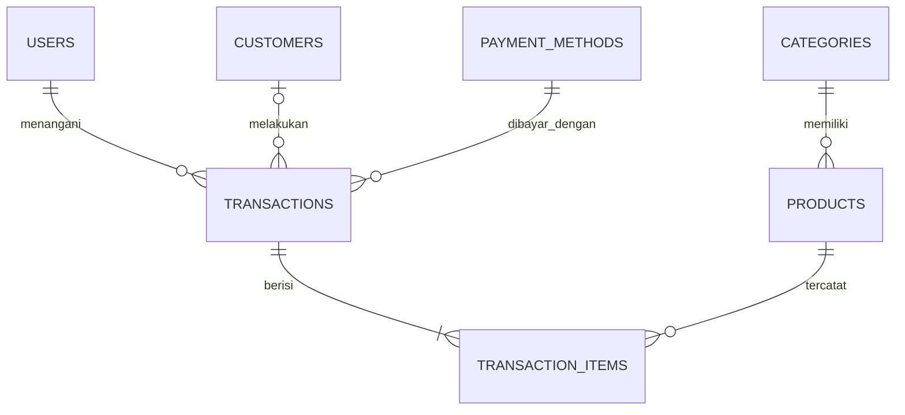
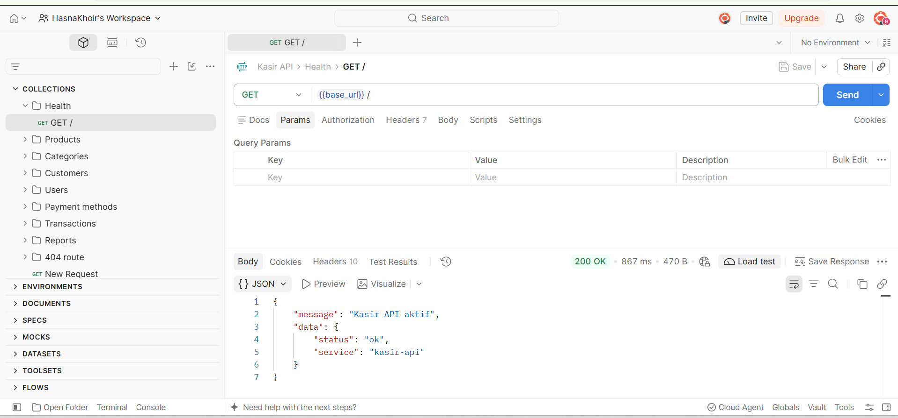
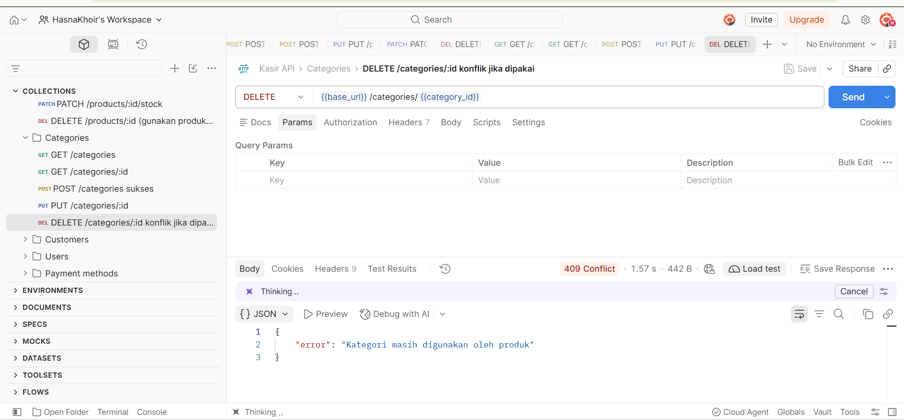

# Kasir API

REST API Point of Sale untuk toko retail, dibuat dengan Node.js ES Modules, Express, dan PostgreSQL. Produk mendukung CRUD dan pencarian; transaksi menyimpan snapshot harga, mengurangi stok secara atomik, dan mengembalikan stok ketika dibatalkan.

**URL deployment:** https://kasir-api-phi.vercel.app 

**Repository GitHub:** https://github.com/HasnaKhoir/kasir-api

## Skema database

Database terdiri atas tujuh tabel: `users`, `categories`, `products`, `customers`, `payment_methods`, `transactions`, dan `transaction_items`. Produk berada dalam satu kategori; transaksi mencatat kasir, pelanggan opsional, dan metode bayar. `transaction_items` menghubungkan transaksi dan produk, sehingga relasinya many-to-many. Item menyimpan `unit_price` sebagai harga saat transaksi.

### ERD (dbdiagram.io)

Skema lengkap, indeks FK, constraint stok/harga/kuantitas, dan seed tersedia di `schema.sql` serta `seed.sql`. ERD format dbdiagram.io tersedia di `erd.dbml`.

## Endpoint

Semua request body menggunakan JSON dan header `Content-Type: application/json`. Respons sukses berbentuk `{"message":"...","data":...}` dan error `{"error":"..."}`. Gunakan URL deployment di atas setelah deploy; contoh lokal memakai `http://localhost:3000`.

### Health check
- Method: GET
- URL: `https://kasir-api-phi.vercel.app/`
- Deskripsi: Memeriksa API.
- Headers: Tidak wajib.
- Request Body: Tidak ada.
- Response Sukses (200): `{"message":"Kasir API aktif","data":{"status":"ok","service":"kasir-api"}}`
- Response Error (500): `{"error":"Terjadi kesalahan pada server"}`

### Daftar produk
- Method: GET
- URL: `https://kasir-api-phi.vercel.app/products?search=beras&category_id=1&page=1&limit=10`
- Deskripsi: Daftar produk dengan filter opsional `search`, `category_id`, `page`, dan `limit` (maksimal 100).
- Headers: Tidak wajib.
- Request Body: Tidak ada.
- Response Sukses (200): `{"message":"Daftar produk berhasil diambil","data":{"items":[{"id":1,"sku":"MKN-001","name":"Beras 5 kg","price":72000,"stock":30}],"pagination":{"page":1,"limit":10,"total":1}}}`
- Response Error (400): `{"error":"page minimal 1 dan limit antara 1 sampai 100"}`

### Detail produk
- Method: GET
- URL: `https://kasir-api-phi.vercel.app/products/1`
- Deskripsi: Mengambil produk berdasarkan ID.
- Headers: Tidak wajib.
- Request Body: Tidak ada.
- Response Sukses (200): `{"message":"Produk berhasil diambil","data":{"id":1,"sku":"MKN-001","name":"Beras 5 kg","price":72000,"stock":30}}`
- Response Error (404): `{"error":"Produk tidak ditemukan"}`

### Tambah produk
- Method: POST
- URL: `https://kasir-api-phi.vercel.app/products`
- Deskripsi: Menambahkan produk baru.
- Headers: `Content-Type: application/json`
- Request Body: `{"category_id":1,"sku":"MKN-011","name":"Biskuit","price":12000,"stock":10,"is_active":true}`
- Response Sukses (201): `{"message":"Produk berhasil ditambahkan","data":{"id":11,"category_id":1,"sku":"MKN-011","name":"Biskuit","price":12000,"stock":10}}`
- Response Error (409): `{"error":"Data duplikat: nilai harus unik"}`

### Perbarui produk
- Method: PUT
- URL: `https://kasir-api-phi.vercel.app/products/1`
- Deskripsi: Mengganti seluruh field produk (category_id, sku, name, price, stock, is_active).
- Headers: `Content-Type: application/json`
- Request Body: `{"category_id":1,"sku":"MKN-001","name":"Beras 5 kg","price":72000,"stock":30,"is_active":true}`
- Response Sukses (200): `{"message":"Produk berhasil diperbarui","data":{"id":1,"sku":"MKN-001"}}`
- Response Error (404): `{"error":"Produk tidak ditemukan"}`

### Perbarui stok produk
- Method: PATCH
- URL: `https://kasir-api-phi.vercel.app/products/1/stock`
- Deskripsi: Mengubah stok saja.
- Headers: `Content-Type: application/json`
- Request Body: `{"stock":25}`
- Response Sukses (200): `{"message":"Stok produk berhasil diperbarui","data":{"id":1,"stock":25}}`
- Response Error (400): `{"error":"stock wajib berupa bilangan bulat >= 0"}`

### Hapus produk
- Method: DELETE
- URL: `https://kasir-api-phi.vercel.app/products/11`
- Deskripsi: Menghapus produk yang belum dipakai dalam item transaksi.
- Headers: Tidak wajib.
- Request Body: Tidak ada.
- Response Sukses (200): `{"message":"Produk berhasil dihapus","data":{"id":11}}`
- Response Error (409): `{"error":"Data masih digunakan atau referensi tidak valid"}`

### Daftar kategori
- Method: GET
- URL: `https://kasir-api-phi.vercel.app/categories`
- Deskripsi: Mengambil semua kategori.
- Headers: Tidak wajib.
- Request Body: Tidak ada.
- Response Sukses (200): `{"message":"Daftar kategori berhasil diambil","data":[{"id":1,"name":"Makanan"}]}`
- Response Error (500): `{"error":"Terjadi kesalahan pada server"}`

### Detail kategori
- Method: GET
- URL: `https://kasir-api-phi.vercel.app/categories/1`
- Deskripsi: Mengambil kategori berdasarkan ID.
- Headers: Tidak wajib.
- Request Body: Tidak ada.
- Response Sukses (200): `{"message":"Kategori berhasil diambil","data":{"id":1,"name":"Makanan"}}`
- Response Error (404): `{"error":"Kategori tidak ditemukan"}`

### Tambah kategori
- Method: POST
- URL: `https://kasir-api-phi.vercel.app/categories`
- Deskripsi: Membuat kategori.
- Headers: `Content-Type: application/json`
- Request Body: `{"name":"Makanan","description":"Bahan pangan"}`
- Response Sukses (201): `{"message":"Kategori berhasil ditambahkan","data":{"id":1,"name":"Makanan"}}`
- Response Error (409): `{"error":"Data duplikat: nilai harus unik"}`

### Perbarui kategori
- Method: PUT
- URL: `https://kasir-api-phi.vercel.app/categories/1`
- Deskripsi: Memperbarui nama dan deskripsi kategori.
- Headers: `Content-Type: application/json`
- Request Body: `{"name":"Makanan Pokok","description":"Bahan pangan"}`
- Response Sukses (200): `{"message":"Kategori berhasil diperbarui","data":{"id":1,"name":"Makanan Pokok"}}`
- Response Error (404): `{"error":"Kategori tidak ditemukan"}`

### Hapus kategori
- Method: DELETE
- URL: `https://kasir-api-phi.vercel.app/categories/1`
- Deskripsi: Menghapus kategori yang tidak memiliki produk.
- Headers: Tidak wajib.
- Request Body: Tidak ada.
- Response Sukses (200): `{"message":"Kategori berhasil dihapus","data":{"id":1}}`
- Response Error (409): `{"error":"Kategori masih digunakan oleh produk"}`

### Daftar pelanggan
- Method: GET
- URL: `https://kasir-api-phi.vercel.app/customers`
- Deskripsi: Mengambil semua pelanggan.
- Headers: Tidak wajib.
- Request Body: Tidak ada.
- Response Sukses (200): `{"message":"Daftar pelanggan berhasil diambil","data":[{"id":1,"name":"Budi Santoso"}]}`
- Response Error (500): `{"error":"Terjadi kesalahan pada server"}`

### Tambah pelanggan
- Method: POST
- URL: `https://kasir-api-phi.vercel.app/customers`
- Deskripsi: Membuat pelanggan; nomor telepon opsional dan unik.
- Headers: `Content-Type: application/json`
- Request Body: `{"name":"Dewi","phone":"081234567890"}`
- Response Sukses (201): `{"message":"Pelanggan berhasil ditambahkan","data":{"id":4,"name":"Dewi","phone":"081234567890"}}`
- Response Error (409): `{"error":"Data duplikat: nilai harus unik"}`

### Perbarui pelanggan
- Method: PUT
- URL: `https://kasir-api-phi.vercel.app/customers/1`
- Deskripsi: Memperbarui nama dan telepon.
- Headers: `Content-Type: application/json`
- Request Body: `{"name":"Budi Santoso","phone":"081200000001"}`
- Response Sukses (200): `{"message":"Pelanggan berhasil diperbarui","data":{"id":1,"name":"Budi Santoso"}}`
- Response Error (404): `{"error":"Pelanggan tidak ditemukan"}`

### Hapus pelanggan
- Method: DELETE
- URL: `https://kasir-api-phi.vercel.app/customers/4`
- Deskripsi: Menghapus pelanggan; transaksi historis mempertahankan transaksi dengan customer_id null.
- Headers: Tidak wajib.
- Request Body: Tidak ada.
- Response Sukses (200): `{"message":"Pelanggan berhasil dihapus","data":{"id":4}}`
- Response Error (404): `{"error":"Pelanggan tidak ditemukan"}`

### Daftar kasir/admin
- Method: GET
- URL: `https://kasir-api-phi.vercel.app/users`
- Deskripsi: Mengambil data kasir/admin tanpa autentikasi.
- Headers: Tidak wajib.
- Request Body: Tidak ada.
- Response Sukses (200): `{"message":"Daftar kasir berhasil diambil","data":[{"id":1,"name":"Admin Toko","role":"admin"}]}`
- Response Error (500): `{"error":"Terjadi kesalahan pada server"}`

### Tambah kasir/admin
- Method: POST
- URL: `https://kasir-api-phi.vercel.app/users`
- Deskripsi: Menambahkan akun data kasir/admin.
- Headers: `Content-Type: application/json`
- Request Body: `{"name":"Kasir Baru","email":"kasir@example.test","role":"kasir"}`
- Response Sukses (201): `{"message":"Kasir berhasil ditambahkan","data":{"id":3,"name":"Kasir Baru","role":"kasir"}}`
- Response Error (409): `{"error":"Data duplikat: nilai harus unik"}`

### Metode pembayaran
- Method: GET
- URL: `https://kasir-api-phi.vercel.app/payment-methods`
- Deskripsi: Mengambil metode pembayaran.
- Headers: Tidak wajib.
- Request Body: Tidak ada.
- Response Sukses (200): `{"message":"Daftar metode pembayaran berhasil diambil","data":[{"id":1,"name":"Tunai"}]}`
- Response Error (500): `{"error":"Terjadi kesalahan pada server"}`

### Daftar transaksi
- Method: GET
- URL: `https://kasir-api-phi.vercel.app/transactions?date=2026-10-25&user_id=2`
- Deskripsi: Daftar transaksi; filter tanggal dan kasir opsional.
- Headers: Tidak wajib.
- Request Body: Tidak ada.
- Response Sukses (200): `{"message":"Daftar transaksi berhasil diambil","data":[{"id":1,"invoice_number":"INV-20261025-9001","status":"selesai"}]}`
- Response Error (400): `{"error":"date harus berformat YYYY-MM-DD"}`

### Detail transaksi
- Method: GET
- URL: `https://kasir-api-phi.vercel.app/transactions/1`
- Deskripsi: Detail transaksi dengan kasir, pelanggan, metode bayar, serta item dan nama produk.
- Headers: Tidak wajib.
- Request Body: Tidak ada.
- Response Sukses (200): `{"message":"Detail transaksi berhasil diambil","data":{"id":1,"cashier_name":"Siti Kasir","payment_method":"Tunai","items":[{"product_name":"Beras 5 kg","quantity":1,"unit_price":72000,"subtotal":72000}]}}`
- Response Error (404): `{"error":"Transaksi tidak ditemukan"}`

### Buat transaksi
- Method: POST
- URL: `https://kasir-api-phi.vercel.app/transactions`
- Deskripsi: Membuat transaksi atomik; harga bersumber dari database, stok dikunci dan dikurangi.
- Headers: `Content-Type: application/json`
- Request Body: `{"user_id":1,"customer_id":2,"payment_method_id":1,"paid_amount":100000,"items":[{"product_id":3,"quantity":2},{"product_id":5,"quantity":1}]}`
- Response Sukses (201): `{"message":"Transaksi berhasil dibuat","data":{"id":4,"invoice_number":"INV-20261025-0001","total_amount":40000,"paid_amount":100000,"change_amount":60000,"status":"selesai"}}`
- Response Error (400): `{"error":"Stok produk Beras 5 kg tidak mencukupi"}` atau `{"error":"Pembayaran kurang dari total belanja"}`

### Batalkan transaksi
- Method: PATCH
- URL: `https://kasir-api-phi.vercel.app/transactions/4/cancel`
- Deskripsi: Membatalkan transaksi dan mengembalikan stok; transaksi hanya dapat dibatalkan sekali.
- Headers: Tidak wajib.
- Request Body: Tidak ada.
- Response Sukses (200): `{"message":"Transaksi berhasil dibatalkan","data":{"id":4,"status":"dibatalkan"}}`
- Response Error (409): `{"error":"Transaksi sudah dibatalkan"}`

### Laporan penjualan harian
- Method: GET
- URL: `https://kasir-api-phi.vercel.app/reports/daily-sales?date=2026-10-25`
- Deskripsi: Total penjualan transaksi selesai, jumlah transaksi, dan produk terlaris. Tanggal default hari ini.
- Headers: Tidak wajib.
- Request Body: Tidak ada.
- Response Sukses (200): `{"message":"Laporan penjualan harian berhasil diambil","data":{"date":"2026-10-25","total_sales":"107000","transaction_count":3,"best_selling_product":{"name":"Mi Instan","quantity_sold":2}}}`
- Response Error (400): `{"error":"date harus berformat YYYY-MM-DD"}`
## Menjalankan lokal

1. Pasang Node.js 20 atau lebih baru dan PostgreSQL cloud (Neon/Supabase).
2. Dari folder project, jalankan `npm install`.
3. Salin `.env.example` menjadi `.env`, lalu isi `DATABASE_URL` dari provider PostgreSQL.
4. Jalankan schema lalu seed pada database yang sama: `psql "$DATABASE_URL" -f schema.sql` dan `psql "$DATABASE_URL" -f seed.sql` (atau gunakan SQL Editor provider).
5. Jalankan `npm start` (atau `npm run dev` untuk mode auto-restart); API tersedia di `http://localhost:3000`.
6. Import `postman_collection.json` ke Postman. Collection variable `base_url` bisa diatur ke server lokal atau URL deployment.

## Deploy ke Vercel

1. Push folder project ke GitHub.
2. Di Vercel, pilih **Add New Project** lalu import repository tersebut.
3. Isi Environment Variables `DATABASE_URL` (connection string PostgreSQL cloud) dan opsional `DB_POOL_MAX`.
4. Pastikan database telah menerima `schema.sql` dan `seed.sql`, lalu deploy.
5. Buka URL deployment dan verifikasi health check `/`.

`api/index.js` mengekspor aplikasi Express sebagai serverless function; pool PostgreSQL dibatasi untuk lingkungan serverless. Tidak ada kredensial dalam repository, dan `.env` masuk `.gitignore`.

## Asumsi

- `PUT /products` dan `PUT /categories`/`customers` mengganti semua field yang dikelola resource; pelanggan tanpa telepon dikirim dengan `phone: null` atau string kosong.
- Data transaksi dan item bersifat historis. Penghapusan produk yang sudah dipakai transaksi ditolak oleh FK agar laporan tidak kehilangan relasi; produk dapat dinonaktifkan.
- `GET /reports/daily-sales` menghitung transaksi berstatus `selesai` saja; transaksi dibatalkan dikecualikan dari omzet dan produk terlaris.
- Nomor invoice memakai sequence global dan tanggal UTC pada proses API; invoice tetap unik dan bertambah aman saat request bersamaan.
- Tidak ada autentikasi sesuai ruang lingkup tugas; endpoint users hanya untuk data kasir/admin.

## Status pengerjaan

- [x] Skema tujuh tabel, foreign key, pivot many-to-many, constraint, dan indeks FK.
- [x] Endpoint resource products CRUD lengkap serta categories, customers, users, payment methods, transactions, dan report.
- [x] Transaksi database atomik, harga server-side, row lock, pengurangan dan pengembalian stok.
- [x] Format respons, error handler, endpoint 404, dan health check.
- [x] Konfigurasi Vercel dan entry point serverless.
- [x] Postman collection berisi request untuk seluruh endpoint dan contoh validasi/transaksi.
- [x] Dokumentasi, ERD, instruksi lokal/deploy, dan asumsi.
- [x] Tidak ada `.env` atau secret di repository.
- [x] Pengujian API lewat deployment Vercel (lihat bagian Bukti Pengujian).

## Bukti Pengujian

Pengujian dilakukan lewat Postman terhadap deployment Vercel
(`base_url` = `https://kasir-api-phi.vercel.app`). Koleksi lengkap ada di
`postman_collection.json`.

### Variabel base_url

### Health check

### Products

### Categories

### Transactions

### Report
